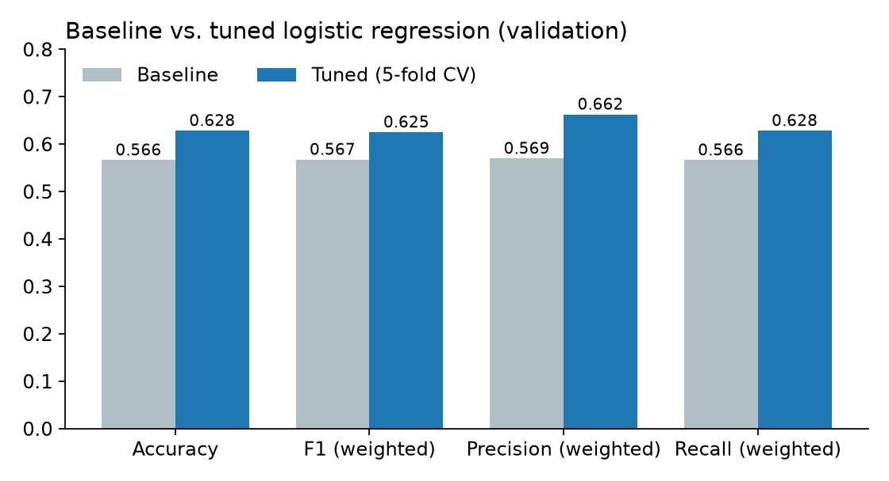
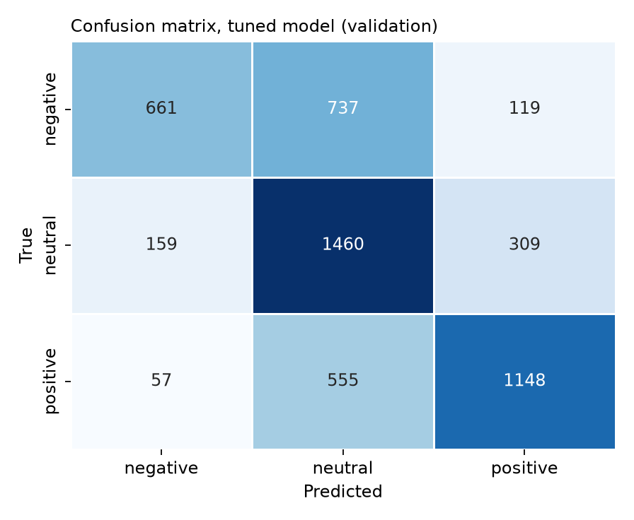
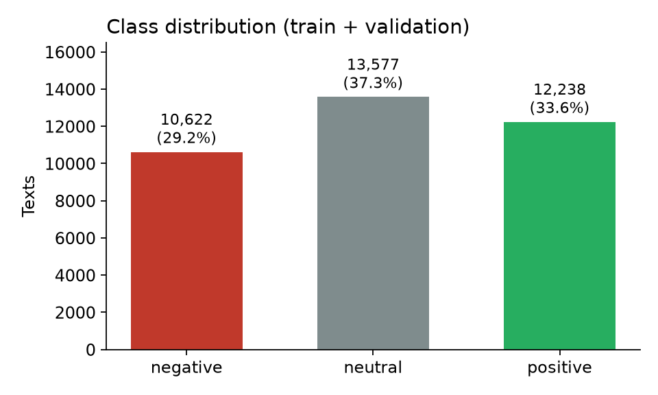

# Sentiment Classification with PySpark

Distributed three-class sentiment classifier (**negative / neutral / positive**) for short English texts,
built with Spark ML. The pipeline covers exploratory analysis, text preprocessing, TF-IDF feature engineering,
a baseline model, cross-validated tuning and error analysis, all on partitioned Parquet data.



## Results

Evaluated on the validation split (5,205 texts). Metrics are weighted across classes.

| Model | Accuracy | F1 | Precision | Recall |
|-------|---------:|---:|----------:|-------:|
| Baseline: logistic regression, `regParam=0.01`, basic cleaning | 0.566 | 0.567 | 0.569 | 0.566 |
| Tuned: 5-fold CV, regex cleaning, `minDocFreq=5` | **0.628** | **0.625** | **0.663** | **0.628** |

The tuned model improves accuracy by 6.2 points. Most remaining errors are between neutral and the two polar
classes; negative and positive are rarely confused with each other.

<p>
  
  
</p>

The baseline and tuned models differ in both preprocessing and tuning, so the gap is the combined effect of the
two rather than of hyperparameter search alone. Section 8 of the notebook scores the held-out test split.

## Pipeline

```
Raw text
  → clean (lower-case, letters only, collapse whitespace)
  → RegexTokenizer
  → StopWordsRemover (English)
  → HashingTF (20,000 buckets)
  → IDF (minDocFreq = 5)
  → LogisticRegression (multinomial)
```

Design choices:

- **No leakage across splits.** Feature statistics (IDF) and the label indexer are fit on the training split only
  and reused for validation and test.
- **Single `Pipeline` objects.** Preprocessing and model are packaged together, so training and inference apply
  the same transformations.
- **Hashing trick.** `HashingTF` avoids building a global vocabulary, which keeps the feature step stateless and
  parallel at scale.
- **Selection metric.** Cross-validation optimises weighted F1 rather than accuracy, because the classes are not
  perfectly balanced (29% / 37% / 34%).

## Dataset

36,437 labelled texts in the train and validation splits (31,232 / 5,205), plus a separate test split.
Average length is 96 characters (max 2,176). Stored as partitioned Parquet with the columns
`id`, `text`, `label`, `sentiment`, `subset`.

## Repository layout

```
.
├── sentiment_classification.ipynb   # full analysis, from EDA to evaluation
├── requirements.txt
└── docs/images/                     # figures used in this README
```

## Running it

The notebook uses standard PySpark ML APIs only. The one environment-specific piece is the first code cell,
which installs Java and PySpark and downloads the data on a fresh Colab runtime. On a cluster that already has
Spark and the data, skip that cell and set `DATA_DIR` in the configuration cell.

Locally:

```bash
python -m venv .venv && source .venv/bin/activate
pip install -r requirements.txt     # also requires a JDK 17+
jupyter lab sentiment_classification.ipynb
```

## Limitations and next steps

- IDF weights are fit on the full training split before cross-validation, which leaks a small amount of
  information between folds. Moving the feature stages into the cross-validated `Pipeline` would remove it.
- TF-IDF ignores word order, negation and sarcasm. Pretrained embeddings or a transformer (for example Spark NLP)
  are the natural comparison.
- Class weights or threshold calibration could help the neutral class, which is where most errors occur.
- Persist the fitted pipeline, track runs with MLflow, and store features and predictions in Delta tables.
